# Singi

A Shopify Online Store 2.0 theme built for storefront rendering speed, clear structure and easy extension by humans and agents alike. Read this file for the overview and quickstart, then follow the links in the docs index.

## Screenshots

<table>
  <tr>
    <td width="50%" valign="top">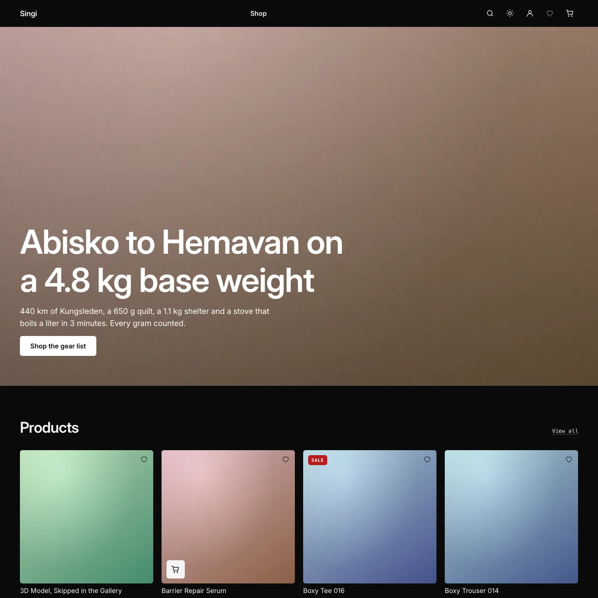<br><sub>Front page</sub></td>
    <td width="50%" valign="top">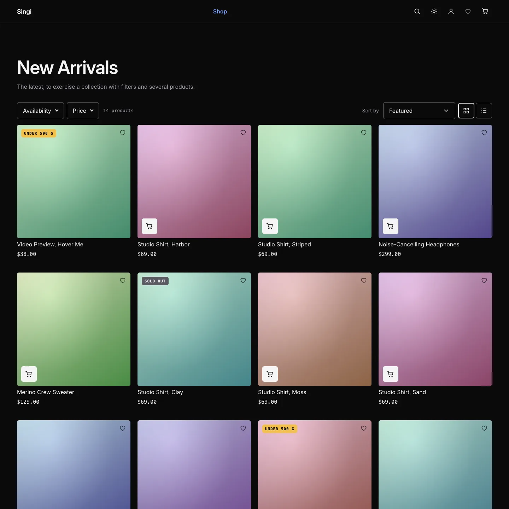<br><sub>Collection</sub></td>
  </tr>
  <tr>
    <td width="50%" valign="top">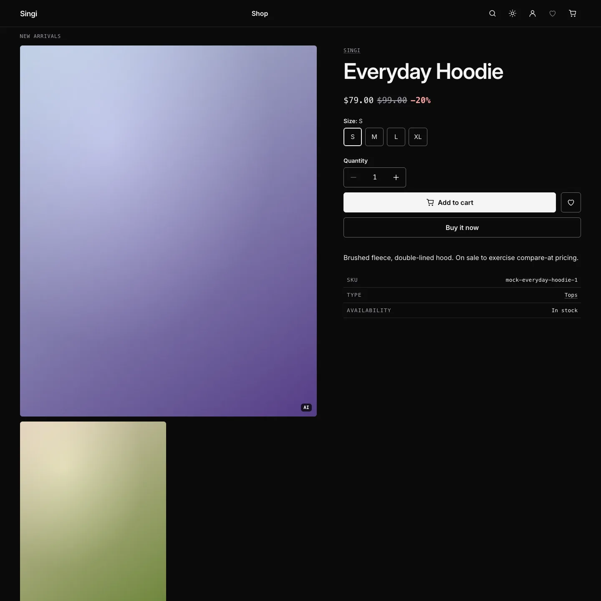<br><sub>Product</sub></td>
    <td width="50%" valign="top">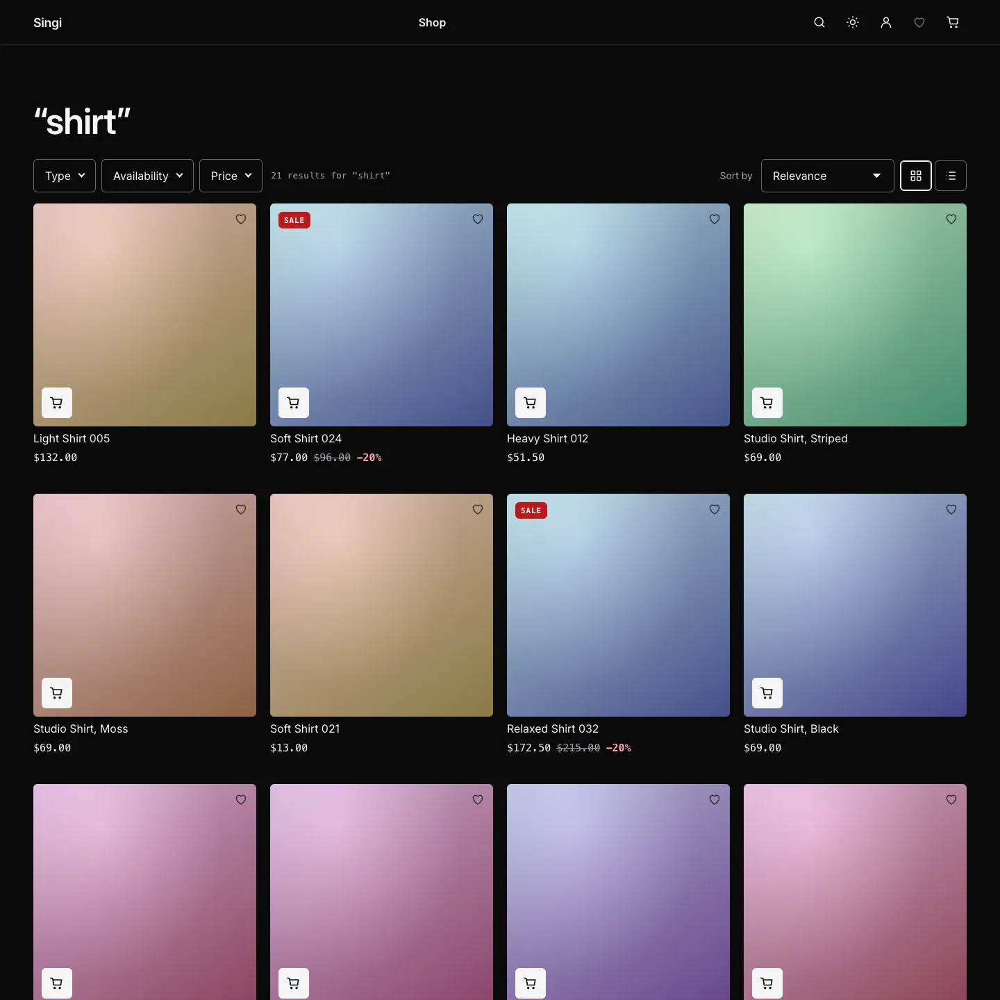<br><sub>Search</sub></td>
  </tr>
  <tr>
    <td width="50%" valign="top">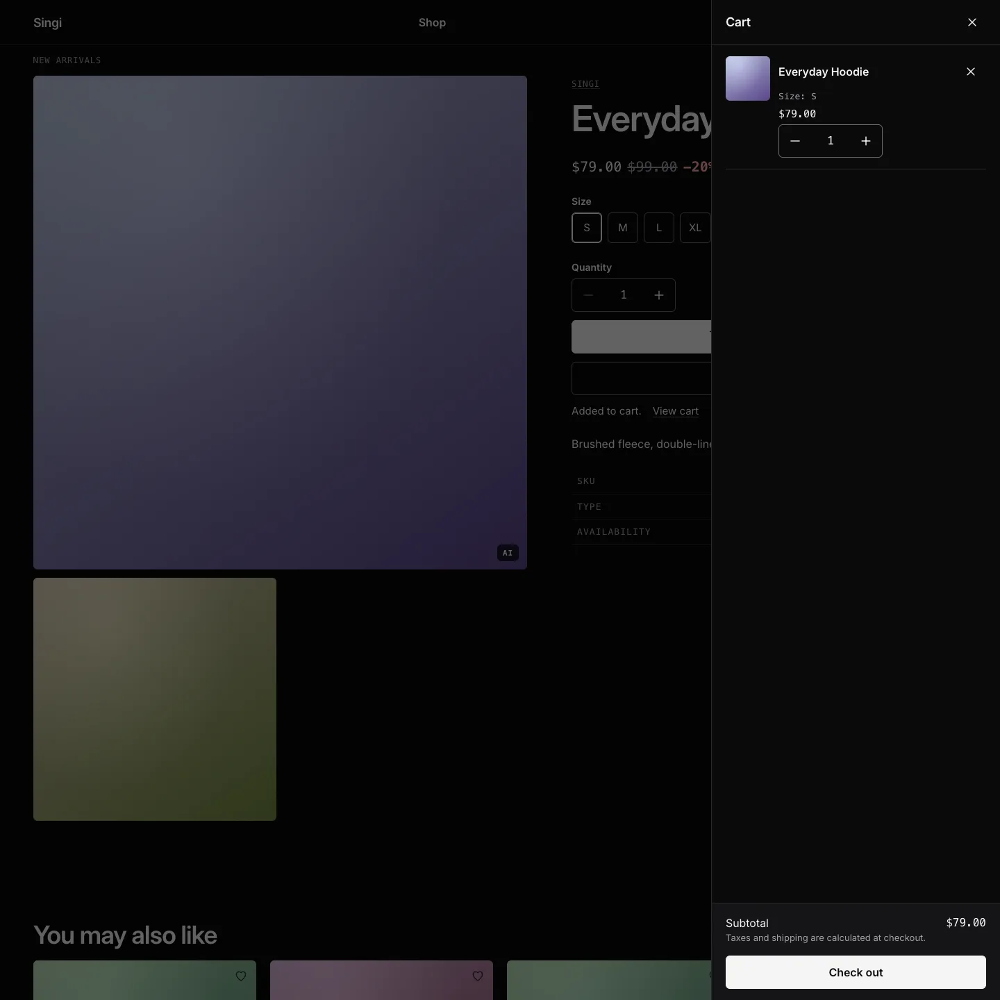<br><sub>Mini cart</sub></td>
    <td width="50%" valign="top">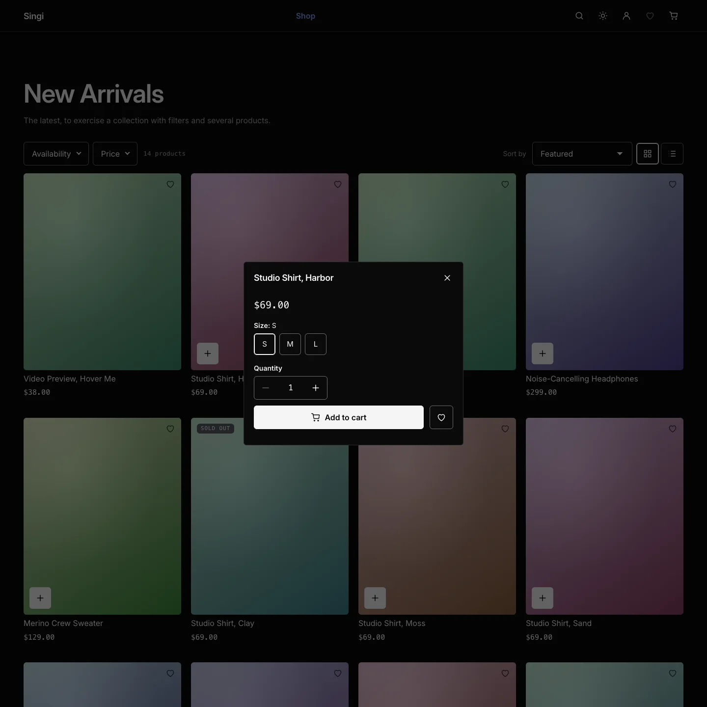<br><sub>Quick add</sub></td>
  </tr>
</table>

<table>
  <tr>
    <td width="33%" valign="top">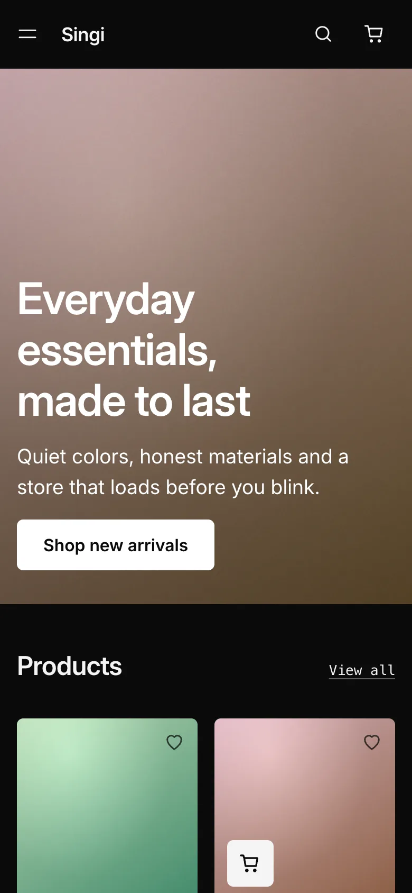<br><sub>Front page</sub></td>
    <td width="33%" valign="top">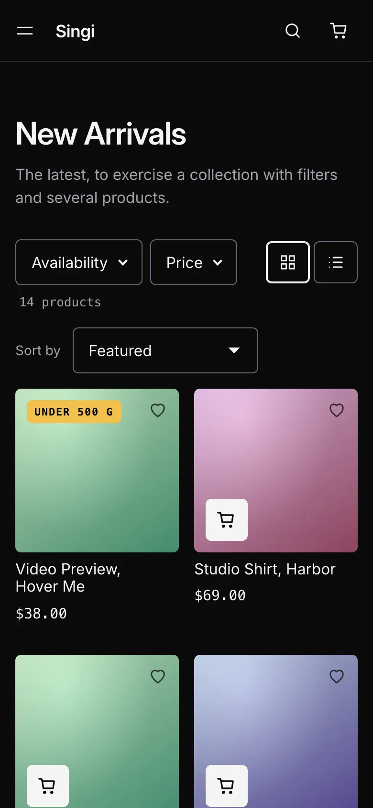<br><sub>Collection</sub></td>
    <td width="33%" valign="top">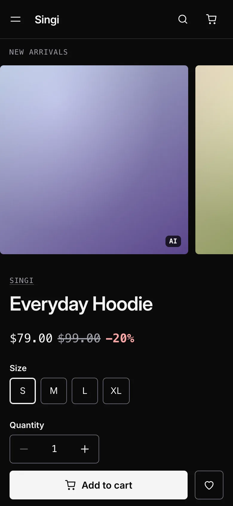<br><sub>Product</sub></td>
  </tr>
  <tr>
    <td width="33%" valign="top">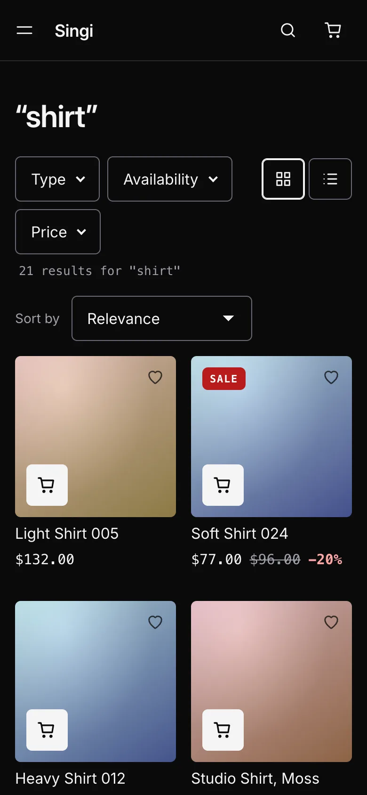<br><sub>Search</sub></td>
    <td width="33%" valign="top">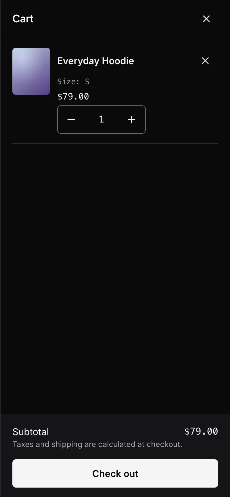<br><sub>Mini cart</sub></td>
    <td width="33%" valign="top">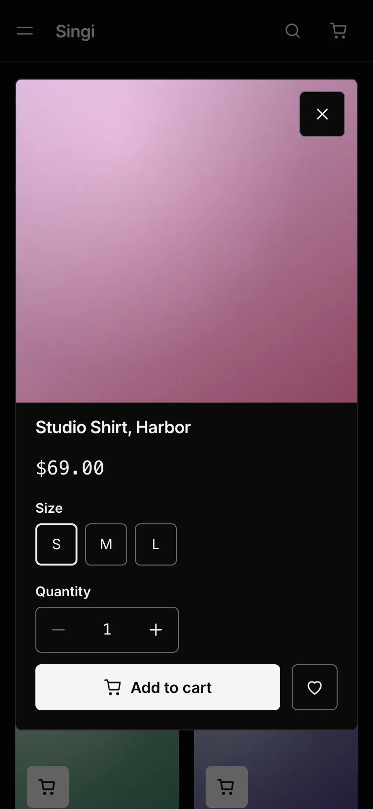<br><sub>Quick add</sub></td>
  </tr>
</table>

The sticky add to cart bar on a phone is shown in [decision 021](docs/decisions/021-sticky-add-to-cart-submits-the-product-form.md), and the content blocks and the component library in the [docs](docs/README.md).

The screenshots show mock content, in dark mode. They are generated by `npm run screenshots` for every release ([releasing](docs/releasing.md)).

## Status

Early. Here is what has and has not been verified:

- `shopify theme check` reports no offenses at any severity, and `npm run check` passes.
- The theme runs on the dev store and its pages have been checked by hand in Chrome. Lighthouse Performance has not been measured on a real storefront yet, so treat the speed claims in these docs as intent until it has. What has been measured is in [Metrics](#metrics).
- Translations in `locales/` are machine-generated and need native review. See [i18n](docs/i18n.md).
- Soft navigation ships off by default. See [soft navigation](docs/soft-navigation.md).

## Metrics

Measured on 2026-11-17 (version 0.1.0) on a development store with mock content, Lighthouse 12.6.1, mobile, median of 3 runs. Full conditions and how to read each column: [testing](docs/testing.md#results).

| | Home | Collection | Product |
| --- | --- | --- | --- |
| Lighthouse accessibility | 100 | 100 | 100 |
| Lighthouse SEO | 100 | 100 | 100 |
| Cumulative Layout Shift | 0 | 0 | 0 |
| Total Blocking Time (upper bound) | 26 ms | 23 ms | 9 ms |
| DOM nodes | 232 | 329 | 330 |
| Theme JavaScript (delivered, brotli) | 7.4 KB | 8.5 KB | 11.6 KB |
| Theme CSS (delivered, brotli) | 8.7 KB | 8.7 KB | 8.7 KB |
| Server render time (Liquid) | 54 ms | 45 ms | 48 ms |

JavaScript and CSS sizes are what Shopify's CDN delivers, from `npm run perf:sizes`; the server render time is from `npm run perf:liquid` (median of 7). The split of the home page's HTML between the theme and Shopify's own scripts was not re-measured; the last figures (2026-11-14) are in [testing](docs/testing.md#results).

**Not published yet: Lighthouse Performance, Best practices, LCP.** The numbers from a development server describe the server (plain `http`, hot reload, platform scripts), not the theme, so they are not shown. They need a run against the real storefront: `npm run perf:lighthouse` ([tooling](docs/tooling.md#perf-lighthouse)). Until then, read the performance claims here as design intent.

## Principles

- **Web-native.** Modern CSS (`light-dark()`, logical properties, popover, `<details name>`, scroll snap), custom elements and native forms. No framework, no polyfills.
- **Server-rendered.** Shopify renders the HTML with Liquid. JavaScript only upgrades what already works without it.
- **Fast by construction.** Critical CSS inlined, first-paint resources above `content_for_header`, one LCP image per page, no global JS bundle, no render-blocking third parties. See [performance](docs/performance.md).
- **Minimal.** A feature earns its place by being worth its bytes: each module has a size budget, and a budget moves only by the measured overage. No slider or carousel component: a product list can scroll sideways with CSS scroll snap, nothing more. The cart drawer, quick buy and the sticky add to cart bar are settings or blocks, each with a record in [docs/decisions](docs/decisions/README.md).
- **Robust.** Every interactive feature has a no-JavaScript path. RTL and dark mode are first-class. Failures fall back to normal navigation.
- **A bit magical.** Small, cheap, CSS-first details (view transitions, skeletons, scroll-driven polish) that never touch the LCP element. See [extending](docs/extending.md#planned).

Typography is restricted to Shopify's official font library (Inter for text, a monospace for accents) so the storefront matches checkout. See [design system](docs/design-system.md#fonts).

## Quickstart

Requirements: Node 20+, [Shopify CLI](https://shopify.dev/docs/api/shopify-cli) 3.x or newer, access to the dev store.

```bash
npm install
npm run dev          # shopify theme dev against the dev store (override with SINGI_STORE)
npm run check        # theme check + repo rules
npm run docs         # regenerate docs/reference/*.md
```

Set `SINGI_STORE` in `.env` to your development store (see [tooling](docs/tooling.md)). Push an unpublished copy to share it:

```bash
shopify theme push --store $SINGI_STORE --unpublished --theme singi-dev
```

Never publish a theme from a script. See [tooling](docs/tooling.md#dev-store-workflow).

## Repo map

```
layout/       theme.liquid (storefront shell), password.liquid
templates/    JSON templates, one per page type, plus gift_card.liquid
sections/     header, footer, hero, featured-collection, content, main-* page sections, *-group.json
blocks/       theme blocks: public (group, heading, text, ...) and private (_product-*, _buy-buttons, ...)
snippets/     tokens, meta-tags, image, icon, price, product-card, pagination, breadcrumbs, skeletons
assets/       base.css (inlined in <head>) and ES modules: utils, soft-nav, product-form, cart-items, facets
config/       settings_schema.json (theme settings), settings_data.json (editor state)
locales/      en.default.json plus one file per language
scripts/      repo checks, reference generator, Lighthouse wrapper, checkout branding sync
docs/         this documentation; docs/reference/ is generated
```

## Documentation index

| Doc | Read it when |
| --- | --- |
| [AGENTS.md](AGENTS.md) | You are a coding agent about to change this repo. Start here. |
| [docs/decisions/](docs/decisions/README.md) | You want to know why something is built the way it is, before you change it. |
| [docs/architecture.md](docs/architecture.md) | You need to know how a request becomes a page, and where CSS and JS come from. |
| [docs/performance.md](docs/performance.md) | You are changing anything that affects load speed, or debugging a metric. |
| [docs/design-system.md](docs/design-system.md) | You are changing colors, fonts, spacing or dark mode. |
| [docs/blocks-and-sections.md](docs/blocks-and-sections.md) | You are composing pages or looking for the right block, section or snippet. |
| [docs/soft-navigation.md](docs/soft-navigation.md) | You are touching client-side navigation or skeletons. |
| [docs/i18n.md](docs/i18n.md) | You are adding strings, a language, or checking RTL. |
| [docs/seo-and-accessibility.md](docs/seo-and-accessibility.md) | You are changing markup, headings, meta tags or structured data. |
| [docs/tooling.md](docs/tooling.md) | You need a command, CI or the dev-store workflow. |
| [docs/checkout-branding.md](docs/checkout-branding.md) | You want checkout, customer accounts and sign-in to match the theme. |
| [docs/search.md](docs/search.md) | You are changing the header search, results as you type, or the search page. |
| [docs/component-library.md](docs/component-library.md) | You want to see every component at once, or check a style change in light, dark and RTL. |
| [docs/media.md](docs/media.md) | You are changing images, focal points, the gallery, video, the card heart or media tests. |
| [docs/extending.md](docs/extending.md) | You are adding a section, block, setting, template, language or integration. |
| [docs/testing.md](docs/testing.md) | You are verifying a change or recording Lighthouse results. |
| [docs/reference/](docs/reference/) | Generated API reference for snippets, blocks and sections (run `npm run docs`). |

## About the name

Singi is named after the STF mountain hut [Singi fjällstuga](https://www.svenskaturistforeningen.se/boende/stf-singi-fjallstuga/) on the Kungsleden in northern Sweden. Singi is not affiliated with Svenska Turistföreningen (STF). Mountain names label what people see (releases, color presets, sample content); code stays plainly named. See [the naming decision](docs/decisions/002-names-literal-in-code-place-names-in-labels.md).

## License

[MIT](LICENSE) © Erik Eng and Singi contributors. Use it on client builds, fork it, sell stores built with it.

The architecture (JSON templates, thin sections, nestable theme blocks) follows the latest approach of Shopify's themes. Write new code from scratch, and only submit code you can license under MIT.

The name "Singi" and its logo are not covered by the MIT license; see [CONTRIBUTING.md](CONTRIBUTING.md#name).
