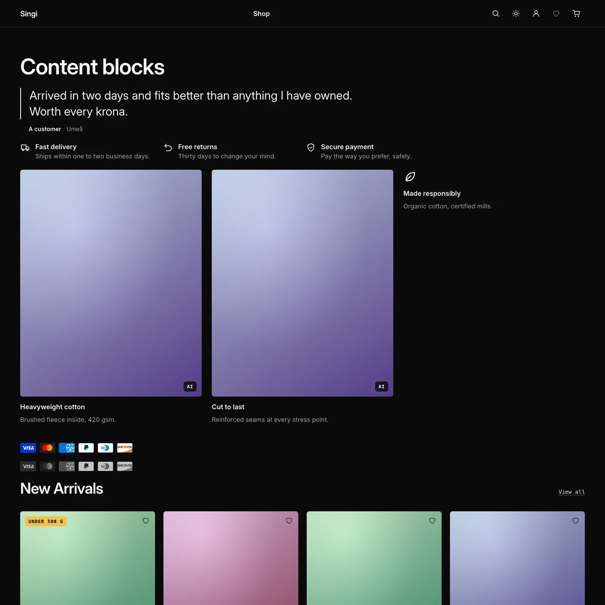

# Blocks, sections and snippets

Catalogue of every block, section and snippet in Singi, how pages are composed in the theme editor, and the conventions each file type follows. Read it to find the right building block or to add a new one consistently. API-level detail (parameters, settings) is generated into [reference/](reference/) by `npm run docs`.

## Conventions

- **Public blocks** have `presets` and can be added in the editor wherever a section accepts `{ "type": "@theme" }`.
- **Private blocks** are prefixed `_`, have no presets, and appear only in sections whose schema names them (as `main-product` does).
- Blocks and snippets start with `` (description, typed `@param`, `@example`). **Sections cannot use ``**; they start with ``.
- Every block root carries `{{ block.shopify_attributes }}` so the editor can select it.
- Schema labels are plain English by decision. Storefront strings go through `| t`.
- CSS lives in the file's ``. Use only classes defined in that file or `assets/base.css`.
- Blocks read `product`, `section` and other globals from the page context. Product blocks assume the product template.

## Public blocks

| Block | Purpose | Key settings |
| --- | --- | --- |
| `group` | Flex container that nests any blocks. | direction, gap, align, justify |
| `heading` | Heading with independent level and visual size. | text, tag (h1-h3), size (sm-xl) |
| `text` | Rich text. | text, size, muted |
| `button` | Link styled as a button. Renders nothing without label and link. | label, link, style |
| `image` | Merchant image with aspect ratio. Always lazy; use `hero` for above-the-fold images. | image, ratio |
| `spacer` | Vertical whitespace. | height |
| `accordion` | Native `
` disclosure. | title, content, open |
| `quote` | A pull quote or testimonial as a figure with a blockquote and a caption (who said it, role or source). Nothing renders without the quote text. | quote, who said it, role or source |
| `product-grid` | A heading, a "view all" link and a grid, or a scrolling row ([decision 037](decisions/037-no-slider-component-one-scrolling-row-for-product-lists.md)), of products from one collection. Put it in a full-width Custom content section. Same cards, image loading and tracking as the Featured collection section, through `snippets/product-grid.liquid`. | heading, collection, products to show (2 to 12) |
| `newsletter` | Signup form with the email input and Subscribe button joined as one control (a Shopify customer form that tags the subscriber `newsletter`; no JavaScript). The footer uses the same `newsletter` snippet. | label, supporting text |
| `payment-icons` | The accepted payment methods as small icons (Shopify's own set, one per enabled type), in color or grayscale. The footer uses the same snippet. [Decision 034](decisions/034-payment-icons-are-one-snippet-with-a-one-color-option.md). | grayscale |
| `usp-list` | A list of short promises (free returns, fast delivery) as role list items, each with an icon, a heading and a line of text. Holds private `_usp-item` blocks; a preset ships icons and no copy; an item with no words renders nothing. No JavaScript. [Decision 025](decisions/025-usp-list-is-a-list-of-item-blocks.md). | layout (side by side or stacked) |
| `feature-list` | Product feature highlights: one to four columns of items, each with a lazy image in one chosen shape (or an icon), a heading and a line of text. Holds private `_feature-item` blocks. No JavaScript. [Decision 026](decisions/026-feature-list-is-a-list-of-item-blocks.md). | columns, image shape |
| `related-products` | Cards for the product's related products (Search & Discovery), filled up from its first collection, rendered on the server with no JavaScript. Hidden when there is neither. See [decision 008](decisions/008-related-products-render-on-the-server.md). | heading, products to show (2 to 8) |
| `recently-viewed` | Cards for the products this visitor opened, newest first. Private to the visitor (localStorage), hidden until there is history, skeletons hold the space. See [media.md](media.md) for cards and `assets/recently-viewed.js` for the flow. | heading, products to show (2 to 8) |

## Private product blocks

| Block | Purpose |
| --- | --- |
| `_product-title` | Page h1 with optional vendor eyebrow. |
| `_product-price` | Price (and unit price) for the selected variant, via `snippets/price.liquid`. |
| `_color-siblings` | Swatch links between separate products that are the same product in another color. Server-rendered, no JS. Data and upkeep: [decision 003](decisions/003-color-siblings-product-list.md), `npm run siblings`. |
| `_size-guide` | A "Size guide" link under the size options that opens its content in a native popover (no JS). Content connects to a metafield; renders nothing when empty. See [metafields](metafields.md). |
| `_product-specs` | Up to eight label and value rows as a table. Each value connects to a metafield; empty rows and an empty table are left out. See [metafields](metafields.md). |
| `_product-policies` | Returns and shipping near the buy button: the store's refund and shipping policy links (when written) and an optional connected summary, for example terms for personalized items. |
| `_variant-picker` | Radio chips from `product.options_with_values`, the legend naming the chosen value only for swatch options ("Color: Grey", [decision 042](decisions/042-an-option-legend-names-its-value-only-when-the-chips-do-not.md), [decision 024](decisions/024-option-labels-name-the-chosen-value.md)), and a picked size is remembered for the visit and preselected on the next product of the same type ([decision 035](decisions/035-a-picked-size-is-remembered-for-the-visit-per-product-type.md)). Fires `change`; handled by `<product-form>`. |
| `_buy-buttons` | Quantity, add to cart, optional dynamic checkout button, status region, and the optional sticky add to cart bar (`snippets/sticky-buy.liquid`, [decision 021](decisions/021-sticky-add-to-cart-submits-the-product-form.md)). Works without JS (the bar only appears with it). Inside the quick buy dialog it leaves out the bar and the checkout button ([decision 022](decisions/022-quick-buy-is-the-product-form-in-a-dialog.md)). |
| `_variants-table` | The order table: one row per variant with a quantity each and one Add to cart ([decision 019](decisions/019-order-table-is-a-product-block.md)). |
| `_usp-item`, `_feature-item` | The items of the `usp-list` and `feature-list` blocks. Private to them. |
| `_product-description` | Product description in `.prose`. |
| `_product-meta` | SKU, type and availability in monospace. |

## Sections

| Section | Purpose | Accepts blocks |
| --- | --- | --- |
| `announcement-bar` | One message above the header from its own settings in the header group (message, optional link, optional dismiss button); nothing while the message is empty; a market can override it and it can be connected to a metaobject. [Decision 027](decisions/027-announcement-bar-is-one-message-from-the-theme-settings.md), [036](decisions/036-announcement-content-lives-in-the-section-not-the-theme-settings.md). | no |
| `header` | Logo, popover navigation, search, theme toggle, account, favorites, cart count. Only the search loads a module. | no |
| `cart-drawer` | One native dialog on every page (in `header-group.json`), opened by the header cart link and after an add to cart; its lines are a `<cart-items>`. Renders nothing when the setting is off. [Decision 020](decisions/020-cart-drawer-reuses-cart-items.md). | no |
| `quick-buy` | The content of the quick buy dialog: the product page's price, option picker and buy buttons for one product. Never placed on a page; fetched from `/products/<handle>?section_id=quick-buy`. [Decision 022](decisions/022-quick-buy-is-the-product-form-in-a-dialog.md). | no |
| `footer` | Tagline, menu, newsletter form, payment icons. | no |
| `hero` | Full-width hero with blocks, in two layouts: text over the image (default) or the image beside the text (two columns from 48em, the image first on a phone, mirrored in right to left; the text uses the page colors, so its contrast never depends on the picture). The image is the LCP candidate when the hero is first. Addable. | `@theme`; layout, height, alignment, overlay, image |
| `featured-collection` | Heading and a grid (or a scrolling row) of products from a collection. Addable. | no |
| `content` | Generic composition container. Addable. | `@theme` |
| `main-product` | Gallery plus `<product-form>` details column. | private product blocks and `@theme` |
| `main-collection` | Filters, sorting (`facets` snippet), grid, pagination inside `<facets-form>`. | no |
| `main-list-collections` | Paginated grid of collections. | no |
| `main-cart` | Cart lines and summary inside `<cart-items>`, then favorites. Blocks fill an empty cart. | `@theme` |
| `main-sitemap` | The HTML sitemap page (template `page.sitemap`): collections, pages and each chosen blog with its latest articles as plain lists; no products, no settings. Add one Blog block per blog. [Decision 033](decisions/033-html-sitemap-is-collections-pages-and-blogs.md). | `Blog` (section blocks) |
| `main-search` | Search results (products as cards, other types as rows); no form, the header search is the one place to search. | no |
| `main-page` | Page title, breadcrumbs, content. | no |
| `main-blog` | Paginated article list. | no |
| `main-article` | Article with LCP featured image. | no |
| `main-404` | Not found. | no |
| `main-password` | Storefront password form (in `layout/password.liquid`). | no |
| `header-group.json`, `footer-group.json` | Section groups for the layout. | n/a |

Header and footer content that merchants control (menus, logo, toggle) comes from theme settings in `config/settings_schema.json`, not section settings.

## Snippets

| Snippet | Purpose | Notes |
| --- | --- | --- |
| `tokens` | Fonts and CSS custom properties from settings. | Rendered once in the layout head. |
| `meta-tags` | Charset, viewport, title, description, canonical, robots, hreflang, OG, Twitter, theme-color, favicon, JSON-LD. | First in head. |
| `image` | Responsive image with priority, eager and lazy modes. | `priority` for one LCP image per page. |
| `icon` | Inline SVG icons: sun, moon, cart, search, account, menu, close, plus, minus, heart, arrow-right, check, chevron-down, grid, list, truck, return, shield, leaf, star, gift, support, lock, clock, package. | `icon--flip` for `arrow-right` in RTL. |
| `social-links` | The footer's social links: plain text links from the theme setting "Social profile URLs", named after the network ([decision 028](decisions/028-social-links-are-text-links-from-the-profile-list.md)). | Rendered by the footer; the same list feeds `schema-site` (sameAs). |
| `sticky-buy` | The sticky add to cart bar. | Rendered by `_buy-buttons`; its button submits the buy box's form. |
| `quantity-input` | Stepper with the variant's quantity rule and hint. | [Decision 015](decisions/015-quantity-limits-follow-the-rule-and-never-name-the-stock.md). |
| `unit-price` | The unit price of a variant. | [Decision 005](decisions/005-unit-price-format-and-instant-update.md). |
| `price` | Price with optional compare-at price. | Monospace. |
| `product-card` | Grid card for a product. | One level of render only. |
| `pagination` | Accessible pagination from a `paginate` object. | Plain links. |
| `breadcrumbs` | Breadcrumb trail plus BreadcrumbList JSON-LD. | The visible trail is the ancestors (metafields or the breadcrumb menu); the current page is only in the JSON-LD. |
| `skeletons` | `<template>` placeholders for soft navigation. | Rendered only when soft navigation is on. |

This table lists the building blocks you meet most. The complete, generated list of every block, section and snippet with its parameters and settings is in [reference/](reference/).

## Composing pages in the editor

- **Home** (`templates/index.json`): a `hero` (heading, text and button blocks) followed by `featured-collection`. Add `content` sections for any custom story, and compose with `group`, `heading`, `text`, `image`, `button`, `accordion`.
- **Product** (`templates/product.json`): `main-product` with blocks title, price, picker, buy, description, meta. Reorder, remove or add `accordion` and other public blocks in the details column. A second section, `recent`, holds the `recently-viewed` block under the product. The **Cart** (`templates/cart.json`) accepts theme blocks that show only while the cart is empty; `recently-viewed` is added by default, so an empty cart offers the products the visitor opened (nothing, if there is no history).
- **App blocks.** The Custom content section and the product section accept app blocks (`@app`), so apps such as Shopify Forms can be added in the theme editor. Not tested here: there is no app on the dev store to add.
- **Other pages** use one `main-*` section. To make a page editable, add `content` sections to its template in the editor.
- Keep exactly one `h1` per page. The hero heading block defaults to `h1` on the home page; `_product-title` is the product h1.

## Adding new building blocks

See [extending.md](extending.md). In short: copy the nearest existing file, keep the conventions above, run `npm run check` and `npm run docs`.
