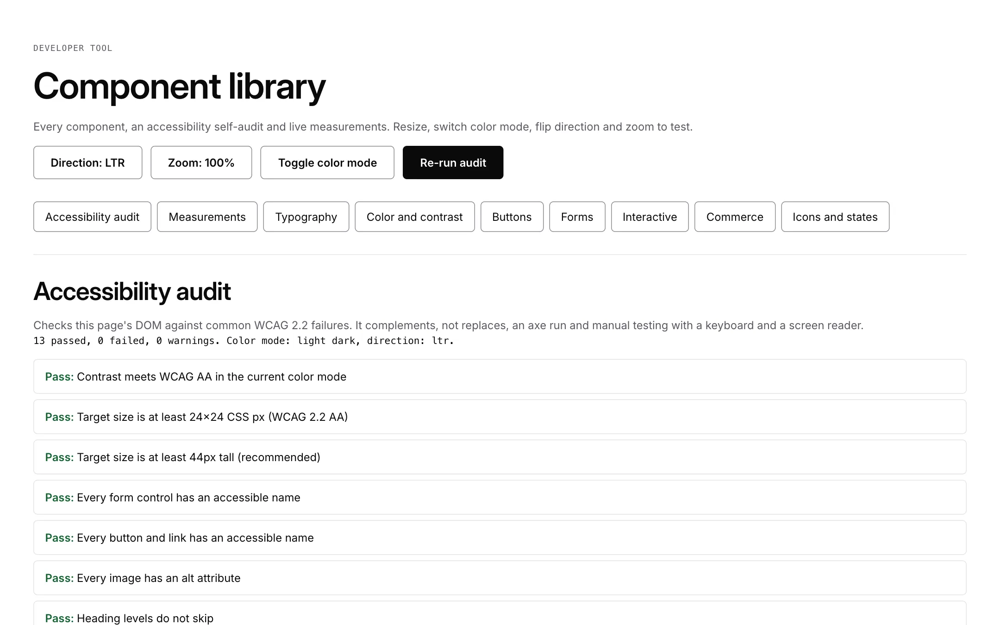

# Component library

A developer-only page that shows every component in one place, so you can check a change against typography, color tokens, buttons, forms, cards, prices, icons and skeletons without hunting through the store. Read it when you change styles, tokens or any shared component.

Source: `templates/page.styleguide.json`, `sections/main-styleguide.liquid`, `assets/styleguide.js`.

## Open it

1. Create the mock content (one time, on your dev store): `npm run mock:apply`. This creates the page `mock-styleguide` with the `page.styleguide` template, plus products, collections and a blog. `npm run mock:plan` prints what it would do without sending anything.
2. Turn the page on: theme editor > Theme settings > Developer > **Enable the component library page**, or `npm run theme:set -- styleguide_enabled=true --apply`. It is off by default and renders nothing until you do.
3. Open `/pages/mock-styleguide` on your store, or `http://127.0.0.1:9292/pages/mock-styleguide` while `npm run dev` is running.

Without the mock content, create a page in the admin and set its template to `page.styleguide`.

## What it shows

- Typography, spacing and the color tokens for light and dark, with live contrast ratios.
- Buttons, form controls, accordions, popovers and other interactive elements.
- Product cards, prices, icons and loading skeletons.
- Controls for text direction (LTR and RTL), zoom and color mode.
- An accessibility self-audit and live performance measurements (LCP, CLS, INP, long tasks).

## Guard rails

- The page is `noindex` (see `snippets/meta-tags.liquid`) and renders nothing when the setting is off. Keep it off on production stores.
- Its copy is English and not translated; `npm run check` allows copy in `templates/page.styleguide.json` only.
- `npm run mock:clean` removes the mock page together with the other mock content.

## Using it in review

For a visual change, open the page before and after, in light, dark and RTL, and attach screenshots to the pull request. See [testing.md](testing.md).
