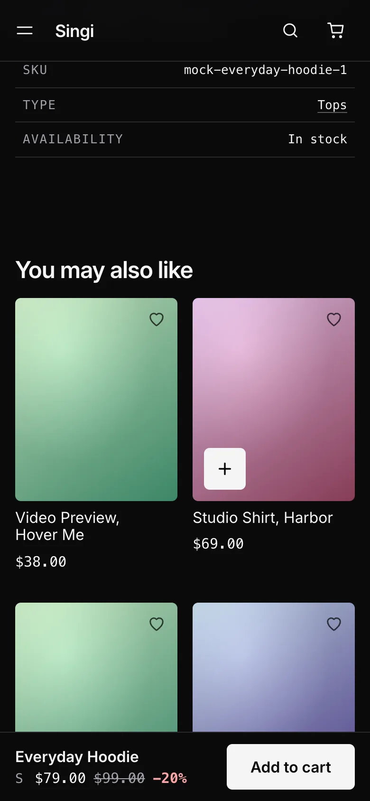

# 021. The sticky add to cart bar submits the product form, and shows only between the buy box and the footer

Status: accepted
Area: product page | cart | accessibility | performance
Code: `snippets/sticky-buy.liquid`, `assets/sticky-buy.js`, `blocks/_buy-buttons.liquid` (setting `show_sticky_bar`, the form `id`)

## Context

On a long product page the Add to cart button scrolls out of sight, and a shopper who has read the details must scroll back to buy. A bar fixed to the bottom edge keeps the action in reach (most useful on a phone). It must not be a second buy box that can disagree with the first, and it must not shift the page when it appears.

## Decision

- **The bar is a snippet rendered by the buy buttons block** when the setting "Show a sticky add to cart bar" is on (default on). It shows the product title, the chosen options (not for a product with one variant), the price, and an Add to cart button.
- **The button submits the existing form** through the `form` attribute (`<button type="submit" form="buy-form-<section id>">`). The add request, the chosen quantity, errors, the cart drawer (decision 020), the cart count and the `singi:cart-add` tracking event are the buy box's own.
- **The bar is fixed, outside the flow,** and hidden with `transform` and `visibility`. Nothing moves when it appears (no layout shift).
- **Shown when the buy box has scrolled out above the viewport and the footer is not yet in view** (a passive `scroll` listener in `<sticky-buy>` that compares the two elements' positions with the viewport). Above the buy box, or at the footer, it is hidden.
- **Updated by the server:** the inside of the bar is a `data-swap="sticky"` region, so `<product-form>` replaces it from the Section Rendering API response when the variant changes (price, options, sold out). It is not updated optimistically, because the shopper changes variants in the buy box, which is on screen then.
- **No JavaScript:** the bar is never shown (it starts hidden and only the script reveals it).
- **A hidden bar is not focusable** (`visibility: hidden`), so Tab never lands on an invisible button.

## Why

- **One form, one behavior:** a second form would need its own variant id, quantity, errors and tracking, and could disagree with the first.
- **Reach on mobile:** the primary action stays one tap away on a long page (see the P0 list in `todo.md`).
- **A passive scroll listener that reads two positions:** it reports the true state after any scroll, including a jump. Browsers dispatch scroll events once per frame and nothing is written unless the state changes. Scroll-driven CSS animation would need no JavaScript but is missing from Firefox and older iOS Safari.
- **Hide at the footer:** the bar would otherwise sit over the legal links and the footer's last lines.

## Alternatives rejected

| Alternative | Why not |
| --- | --- |
| A second `<form>` with its own hidden `id` and quantity | Can disagree with the buy box; more code and tracking to keep in step. |
| `position: sticky` on the buy box | Keeps the whole box on screen, which is too large on a phone and fights the gallery layout. |
| `IntersectionObserver` on the buy box and the footer | Misses jumps (see edge cases), which the test caught. |
| Scroll-driven CSS animation (`animation-timeline: view()`) | No JavaScript, but not in Firefox or iOS Safari before 26, where the mobile shoppers are. |
| Reserving space at the bottom of the page for the bar | A permanent empty strip under the footer. Hiding at the footer needs no space. |

## Edge cases and dead ends

- **The `form` attribute needs the form's `id`.** `blocks/_buy-buttons.liquid` sets it from the section id; keep both in step if you change one.
- **A `data-swap` region is replaced as a whole.** Do not put the `<sticky-buy>` element itself inside it: its observers live on the element. Only the inside (`.sticky-buy__inner`) swaps.
- **A transformed ancestor breaks `position: fixed`.** Do not add `transform`, `filter` or `contain` to `product-form` or its parents.
- **The bar adds the quantity chosen in the buy box,** and an out of range quantity is reported by the browser on the buy box's input, which may be off screen.

- **Do not use `IntersectionObserver` for this.** It reports only when an element crosses the edge of the viewport. A jump from above the buy box to below it (a restored scroll position, the End key, an anchor link, `scrollTo`) never crosses it, no callback runs, and the bar never shows. A scroll listener that reads the positions has no such gap.
- **On a wide screen the bar never shows,** because the details column is sticky and the buy box stays on screen. That is intended.

## Trade-offs we accept

- **One more script on product pages** (238 bytes brotli source, less delivered). The total JavaScript budget went from 21950 to 22190: the measured overage of 219 bytes plus a little slack.
- **The bar's price lags a variant change by the server round trip.** The shopper is looking at the buy box then.

## How to verify

`npm run check`; `npm run test:sticky-buy` with `npm run dev` running. By hand on a dev store: scroll past the buy box (the bar slides up), press its button (the item is added and the drawer opens), change a variant and scroll again (price and options follow), scroll to the footer (the bar hides), turn the setting off. Nothing here has been measured on a live store.

## Revisit when

Scroll-driven animations reach Firefox and the iOS versions in use (the script could go), or the bar needs variant choice inside it.
