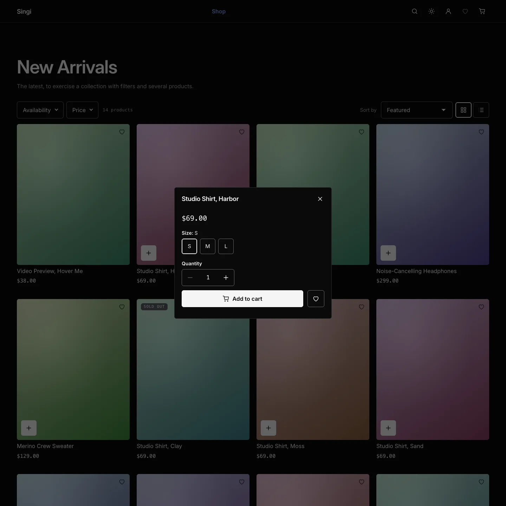

# 022. Quick buy is the product page's own form in one dialog, rendered by the server, opened by a card button

Status: accepted
Area: product card | cart | accessibility | performance
Code: `sections/quick-buy.liquid`, `assets/quick-buy.js`, `snippets/product-card.liquid` (`.card-add--options`, dialog CSS), `blocks/_buy-buttons.liquid` (`in_dialog`), `assets/product-form.js` (no address change inside a dialog), `layout/theme.liquid`, setting `card_quick_buy`

## Context

Decision 012 gave single-variant products a one press add. Products with options had nothing: choosing a size or color needs the product page. A shopper who knows what they want should be able to choose and add without leaving the list. A second picker built for the card would duplicate the product page's variant, price, quantity and quantity rule handling.

## Decision

- **A plus button on the card image** (same look and place as quick add, `.card-add`) for in-stock products with more than one variant that do not require a selling plan, when the setting "Let shoppers choose options from product cards" is on (off by default). It is a `<button>` named "Choose options for <title>" (`wishlist.choose_options`), with `aria-haspopup="dialog"` and the product URL in `data-quick-buy`. **A card keeps exactly one link** (decision 001): a second link to the same page would repeat in a screen reader's link list.
- **Without JavaScript the button is hidden** (`<noscript><style>` in the head, for quick add as well); **when the fetch fails, it takes the shopper to the product page** (`location.assign`).
- **One native `<dialog>`, created by `assets/quick-buy.js` on first use.** Pressing the link fetches `<product url>?section_id=quick-buy` and puts the result in the dialog. The section `quick-buy` renders the product page's own blocks (price, variant picker, buy buttons) as static private blocks inside a `<product-form>`. So choosing an option, the quantity rules, the unit price, add to cart, errors and tracking are the product page's code, not a copy. A variant change re-fetches the same section (the form's `data-section-id` is `quick-buy`).
- **No address change:** inside a dialog `<product-form>` does not call `history.replaceState`, so the list URL stays.
- **The buy buttons block leaves out the sticky bar and the dynamic checkout buttons** when its section id is `quick-buy` (`in_dialog`).
- **After an add** the dialog closes when the cart drawer exists (decision 020), so the drawer is the only one open; without the drawer it stays and shows the form's own "Added to cart" line and cart link.
- **Closing:** the close button, Escape, a click on the backdrop and soft navigation. Focus returns to the card link (native).
- **The scripts load only when the setting is on** (`product-form.js` and `quick-buy.js`, from `layout/theme.liquid`).

## Why

- **One implementation of buying:** the product page's form already handles every edge (quantity rules, sold out options, unit price, tracking). Reusing it through the Section Rendering API means a fix there fixes the dialog.
- **Real links:** a link works for crawlers, middle clicks, no-JS and a failed fetch (rule 25).
- **Native dialog:** focus trap, inert page, Escape and focus return for free (decisions 014, 020).
- **Nothing on the card but one link,** so a page of cards gains one node per eligible card and no data about variants.

## Alternatives rejected

| Alternative | Why not |
| --- | --- |
| A picker built into the card from `product.variants` | A second picker to keep in step, and a loop over variants per card (AGENTS.md rule 7). |
| Fetch the whole product page and cut out the form | Heavy, and brings the gallery and the page's scripts. |
| A second `<a>` on the card, a link to the product page | Breaks the one link per card rule (decision 001: duplicate links in a screen reader's list); the tests that count links caught it. A button hidden without JavaScript gives the same fallback. |
| Reuse the first available variant (as quick add does for one variant) | Sells a size or color the shopper never chose (decision 012). |

## Edge cases and dead ends

- **Static private blocks work, but their settings cannot be set from the section.** Passing `show_sticky_bar: false` to `content_for 'block'` does nothing; the block's defaults apply. That is why `_buy-buttons` checks `section.id == 'quick-buy'`. If you rename the section, change both.
- **Ids are per section.** The dialog's inputs use `option-quick-buy-…`, its form `buy-form-quick-buy`, so they never collide with the page's own product form (a product page with related product cards can open the dialog).
- **Linting.** Classes in the section markup would be flagged (`ValidScopedCSSClass`) because the dialog's CSS lives in the product card's stylesheet, so the fetched section uses only base classes and a `data-` hook. The dialog itself is styled by `.quick-buy` rules in `snippets/product-card.liquid`.
- **Compiled CSS.** The blocks' own `` rules (picker, quantity, buy buttons) must be present on the page that shows the dialog. On the dev theme the compiled stylesheet is one file for every page (61,189 bytes on a collection, product, cart and page alike), so it works there. AGENTS.md says Shopify subsets compiled CSS per page; if a live store does, the dialog would be partly unstyled on pages that never render those files. Not verified on a live store. If it happens, render the blocks' CSS where the cards are or move the shared rules to `assets/base.css`.
- **`quantity-input.js` loads with `product-form.js`** (both from `layout/theme.liquid` when the setting is on): the quantity control arrives in the fetched dialog markup, where scripts do not run, and a collection page has not rendered it, so its stepper buttons stay invisible. Found from a screenshot; `test:quick-buy` checks the buttons are shown.
- **Recently viewed:** `<product-form>` records the product when it connects, so opening quick buy counts as viewing it. Accepted.
- **A product with a selling plan, or sold out,** gets no button and keeps the plain card.
- **Modified clicks** (new tab) are not a thing for a button; the product page is one tap away through the card's own link.

## Trade-offs we accept

- **Two scripts on pages with cards when the setting is on:** `quick-buy.js` is 450 bytes brotli source; `product-form.js` is loaded on list pages too. The total JavaScript budget went from 22190 to 22660 (measured overage of 446 plus slack).
- **The dialog opens after a round trip** (the section fetch), with the button marked `aria-busy` meanwhile. No optimistic content.

## How to verify

`npm run check`. With the setting on for the dev theme (`npm run theme:set -- card_quick_buy=true --theme <singi-dev id> --apply`) and `npm run dev` running: `npm run test:quick-buy` (19 checks). By hand: open it from a collection, search results and a product page's related products; choose options; add; the drawer opens. Nothing here has been measured on a live store.

## Revisit when

Shopify supports setting static block settings from a section, a live store shows the compiled CSS is subset per page, or quick buy needs a gallery image in the dialog.
