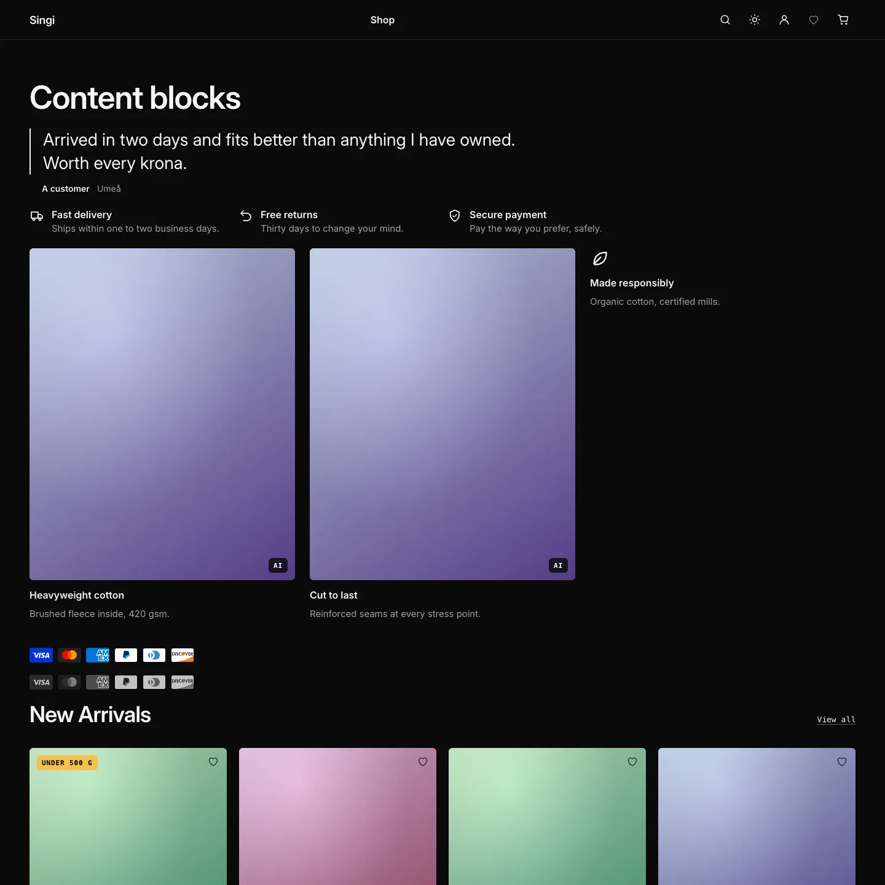

# 025. A USP list is one public block holding private item blocks, with plain list semantics and no script

Status: accepted
Area: content blocks | product page | accessibility
Code: `blocks/usp-list.liquid`, `blocks/_usp-item.liquid`, `snippets/icon.liquid` (ten new icons), `templates/page.blocks.json` (demo), `scripts/test-usp.mjs`

## Context

Shipping, returns, payment and quality promises reduce uncertainty close to the decision to buy (Baymard and NNG, see the research basis in `todo.md`). A merchant needs to place a short list of them in a content section and on the product page, editable in the theme editor, without an app and without script.

## Decision

- **One public block, `usp-list`, holding private `_usp-item` blocks** (icon, heading, text). It works in every section that accepts theme blocks (`@theme`), including the product page's details column, and a merchant adds, reorders and removes items in the editor.
- **Markup:** a `div role="list"` with one `div role="listitem"` per promise (the platform wraps each block in a `div`, so native `ul` and `li` cannot be used). The icon is an inline SVG from `snippets/icon.liquid`, `aria-hidden`; the words carry the meaning.
- **Layout setting:** side by side (a grid that wraps, items at least 13rem wide) or one under the other.
- **An item with neither heading nor text renders nothing,** so its text can be connected to a metafield (a dynamic source) and the item disappears for products without it. A list with no visible item shows a hint in the theme editor and nothing on the storefront.
- **A preset ships no copy** (a repo rule): a new list has three items with icons and no words. The merchant writes them. The mock page `/pages/mock-blocks` carries example copy and an empty item to exercise the rule.
- **Ten icons** were added to the shared icon snippet: truck, return, shield, leaf, star, gift, support, lock, clock, package. They are drawn for this theme (24 x 24, stroke only, the existing icon style).
- **No JavaScript, no image files.**

## Why

- **Nested blocks:** the list owns the layout, the item owns its content, and the editor offers exactly one child type, so a list cannot contain unrelated blocks.
- **Plain semantics:** a list lets a screen reader say "list, 3 items" and lets a shopper skip it.
- **Shared icons:** one snippet, one style, no third-party icon set and no per-item image upload to size and cache.
- **Dynamic sources:** keeping an empty item invisible follows the accordion block's pattern.

## Alternatives rejected

| Alternative | Why not |
| --- | --- |
| One block with numbered settings (icon 1, heading 1, ...) | A fixed count, and the editor cannot reorder or remove items. |
| An image per item | A merchant must produce and upload icons; an inline SVG is lighter and follows the text color. |
| A section instead of a block | Cannot sit inside the product page's details column. |
| `ul` and `li` | The platform's block wrappers sit between them; an invalid list is worse than ARIA roles. |

## Edge cases and dead ends

- **Do not put copy in the preset.** `npm run check` fails it ("presets must not ship text").
- **Item CSS lives in the item block and layout CSS in the list block,** because a class used by one file and defined in the other is flagged (`ValidScopedCSSClass`) and may be missing on a page that renders only one of them.
- **A long heading wraps** inside the item; `min-width: 0` on the body keeps it from pushing the grid wider.
- **On the product page** the list belongs under the buy buttons (add it in the editor); it is not in the default product template.

## Trade-offs we accept

- **The icon snippet grew by about 1.1 KB of source** (it is rendered inline wherever an icon is used; only the chosen branch of the `case` is emitted).
- **Ten icons are a closed set:** a merchant who wants another asks for it (or uses the none option).

## How to verify

`npm run test:usp` with `npm run dev` running (the example list is on `/pages/mock-blocks`), and `npm run check`. Nothing here has been measured on a live store.

## Revisit when

Merchants ask for custom icons or a link per item.
