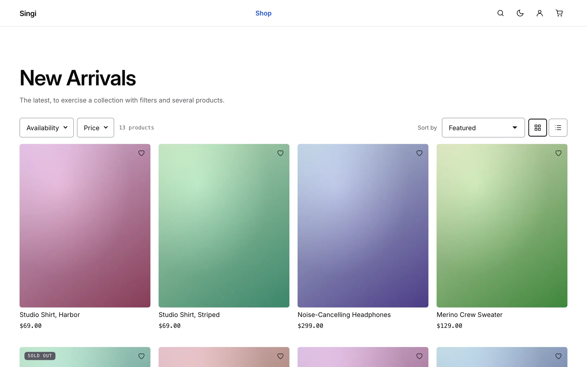
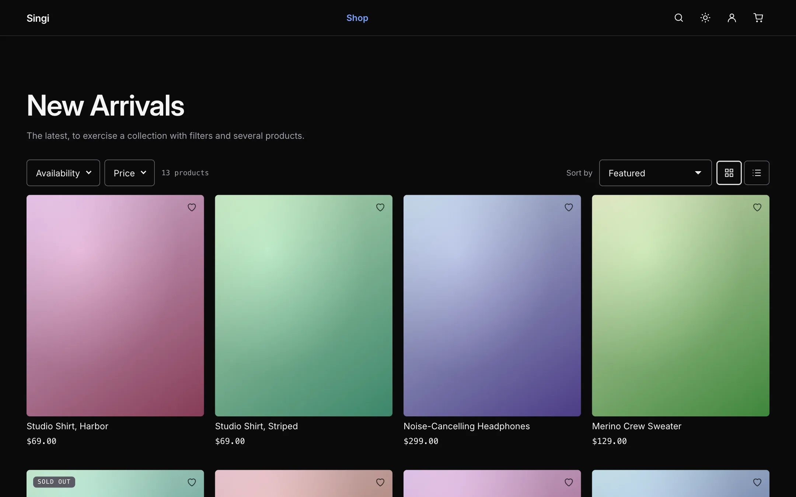

# Design system

Tokens, color schemes, fonts, spacing and component styling in Singi, and how to change the look without breaking performance, dark mode or RTL. Read it before touching colors, typography or base styles.

Style direction: bespoke, minimal, restrained. Hairline borders, small radius, generous space, Inter for text, monospace for prices, labels and metadata.

## Tokens

Settings in `config/settings_schema.json` become CSS custom properties in `snippets/tokens.liquid` (inline `<style>` in `<head>`). `assets/base.css` defines a few static tokens.

| Token | Source | Meaning |
| --- | --- | --- |
| `--font-sans` | `settings.font_body` | Text and heading stack. Includes `"Inter Fallback"` and `system-ui` when appropriate. |
| `--font-mono` | `settings.font_mono` | Monospace stack for prices, eyebrows, SKUs, counts. |
| `--font-weight-body` | font weight | 400 for Inter. |
| `--font-weight-strong` | body font at weight 600 | Headings, strong text, buttons, labels. |
| `--page-width` | `settings.page_width` | 72rem, 84rem or 100rem. |
| `--radius` | `settings.radius` | Corner radius in px. |
| `--logo-width` | `settings.logo_width` | Logo width in px. |
| `--color-bg`, `--color-surface`, `--color-fg`, `--color-muted`, `--color-border`, `--color-accent` | light and dark color settings | Resolved with `light-dark()`. |
| `--gutter` | `base.css` | `clamp(1rem, 4vw, 2rem)` page side padding. |
| `--header-h` | `base.css` | 4rem sticky header height. |
| `--tracking-tight`, `--tracking-wide` | `base.css` | Letter-spacing. Zeroed for RTL, CJK, Thai and Indic. |

Use these tokens in CSS. Do not hardcode colors, radii or fonts.

## Light and dark scheme

 

Colors are defined twice in settings (Colors: light, Colors: dark) and combined in `tokens.liquid`:

```css
--color-bg: light-dark(#ffffff, #0a0a0b);
```

`light-dark()` picks a value from the used `color-scheme`. `assets/base.css` sets:

```css
:root { color-scheme: light dark; }          /* follow the device */
:root[data-theme=light] { color-scheme: light; }
:root[data-theme=dark]  { color-scheme: dark; }
```

`data-theme` is set in two places:

1. Server side, when `settings.color_mode` is `light` or `dark`.
2. By the inline script in `layout/theme.liquid`, which reads `localStorage['singi-theme']` before first paint (no flash) and handles clicks on any `[data-theme-toggle]` button. The toggle flips between light and dark, based on the current resolved mode, and stores the choice.

The toggle icon switches in CSS (`.theme-toggle .i-sun`, `.i-moon`) using the same `data-theme` and `prefers-color-scheme` rules. `<meta name="theme-color">` is emitted twice with media queries, and `<meta name="color-scheme">` is set.

Default palette contrast: foreground and muted text on background are chosen to meet WCAG AA on both schemes. Re-check contrast whenever you change a color setting (see [seo-and-accessibility.md](seo-and-accessibility.md#contrast)).

Hero text sits on an image with an overlay and uses fixed white text; keep the overlay at 40% or more.

## Fonts

Only fonts from Shopify's font library are allowed, so storefront and checkout match. This is enforced structurally (`font_picker` settings) and by `scripts/check.mjs` (no literal `font-family`, no remote or hosted font files).

- **Body and headings:** `settings.font_body`, default `inter_n4`. Weights 400 and 600 are loaded (`font_face` for the base variant and `font_modify: 'weight', '600'`). Both are preloaded as woff2 in `layout/theme.liquid`. No italic variant is loaded; browsers synthesize italics if needed.
- **Monospace accents:** `settings.font_mono`, default `mono` (the system monospace, 0 bytes). Pick any monospace from the library (for example `geist_mono_n4`, `ibm_plex_mono_n4`, `roboto_mono_n4`, `source_code_pro_n4`, `space_mono_n4`) if a downloaded one is wanted; it is then loaded with `font-display: swap` and is not preloaded.
- **Fallback metrics:** when the body font is Inter, `tokens.liquid` adds an `Inter Fallback` face over `local('Arial')` with `size-adjust: 107.4%`, `ascent-override: 90.2%`, `descent-override: 22.48%`, `line-gap-override: 0%`. These are commonly used values for Inter over Arial. They have not been measured against the Inter files Shopify serves. Measure on the dev store (render the same text with fallback and web font, compare heights and widths) and adjust before relying on the CLS result.
- **Script coverage:** Inter has no Arabic, Hebrew, CJK or Indic glyphs. The stack includes `system-ui` so system fonts fill in. See [i18n.md](i18n.md#fonts-and-script-coverage).
- **Headings and strong text** use `--font-weight-strong` (600). Heading line-height is 1.15, body 1.5 (unitless, to avoid swap-induced layout shift).

## Type scale

| Element | Size |
| --- | --- |
| `h1` | `clamp(2rem, 1.4rem + 2.6vw, 3.25rem)` |
| `h2` | `clamp(1.5rem, 1.2rem + 1.4vw, 2.25rem)` |
| `h3` | `1.25rem` |
| Body | `1rem` |
| `.eyebrow` | `0.75rem`, monospace, uppercase, `--tracking-wide`, muted |
| Price | `0.9375rem`, monospace |

The heading block (`blocks/heading.liquid`) offers `sm`, `md`, `lg`, `xl` sizes independent of the heading level.

## Spacing and layout

- `.container`: `width: min(100% - 2 * var(--gutter), var(--page-width)); margin-inline: auto`.
- `.section`: vertical padding `clamp(2.5rem, 6vw, 5rem)`.
- `.stack > * + *`: vertical rhythm using `--stack` (default `1rem`).
- Breadcrumbs add no spacing of their own. Their 2.75rem line box gives about `1rem` above and below the 12px text, so the gap under the header and the gap above the page content are both `1rem`, on every page and screen size. A section that starts with a breadcrumb has no top padding.
- Grids: `.product-grid` is 2 columns on small screens, 3 from 40em, 4 from 56em. The mobile and desktop breakpoint is `56em`.
- Touch targets are at least 44px (`2.75rem`), most controls `3rem`.

## Components

| Component | Where | Notes |
| --- | --- | --- |
| Button | `.button`, `.button--secondary`, `.button--block` in `base.css` | Primary is inverted foreground on background. |
| Inputs | `input`, `select`, `textarea` in `base.css` | 3rem tall, radius token. |
| Chip (variant option) | `blocks/_variant-picker.liquid` | Real radios, visually hidden, styled labels. |
| Product card | `snippets/product-card.liquid` | 4:5 media, stretched link, sold-out badge. |
| Price | `snippets/price.liquid` | Monospace, visually hidden sale and regular labels. |
| Accordion | `blocks/accordion.liquid` | Native `<details name="accordion">`. |
| Pagination | `snippets/pagination.liquid` | Plain links, `rel=prev|next`. |
| Breadcrumbs | `snippets/breadcrumbs.liquid` | Plus JSON-LD. |
| Skeleton | `.skeleton` in `base.css`, shapes in `snippets/skeletons.liquid` | Shimmer disabled under `prefers-reduced-motion`. |
| Icons | `snippets/icon.liquid` | Inline SVG, stroke icons, `icon--flip` mirrors in RTL. |

## Price formatting

Prices are formatted with Shopify's money filters, so the currency, symbol, separators and position follow the store's currency format and the visitor's market. The setting **Hide .00 on whole prices** (Theme settings > Appearance, `price_trim_zeros`, off by default) switches every displayed price to `money_without_trailing_zeros`: $79.00 becomes $79, while $79.50 stays $79.50. It never rounds. It covers cards, the product page (including the price that updates when an option is chosen), the unit price, the cart and favorites.

Where it applies, and what each place costs:

| Place | File | Notes |
| --- | --- | --- |
| Current and compare-at price on cards, product page, search, favorites, recently viewed | `snippets/price.liquid` | One snippet, three branches. |
| Price that updates when an option is chosen | `blocks/_variant-picker.liquid` (`data-price`) | Inline branch, not a snippet: it runs once per variant, so a render per variant would add cost. |
| Unit price ("$78 / 100 ml") | `snippets/unit-price.liquid` | The same setting, so a unit price and its price never disagree. |
| Cart line total and subtotal | `sections/main-cart.liquid` | |
| Not affected | `snippets/meta-tags.liquid`, `schema-*`, `templates/gift_card.liquid` | Structured data keeps exact amounts; the gift card page is a customer facing exception. |

Measured (`npm run perf:liquid`, median of 7): the product page renders in 32.5 ms and the 12 variant product in 39.8 ms with the branches in place, against 35.3 ms recorded before them. No JavaScript is involved.

Two rules keep it consistent. Every displayed price that uses `| money` must sit beside a `settings.price_trim_zeros` test; `npm run check` fails otherwise. Structured data (`snippets/meta-tags.liquid`, `schema-*`) and the gift card page are exempt: search engines get the exact amount. `npm run test:price-format` checks both modes (`SINGI_TRIM=1` for the trimmed one).

## Changing the look safely

1. Prefer changing a setting or a token over editing component CSS.
2. If you add a color, add a light and a dark setting and wire both through `light-dark()` in `tokens.liquid`.
3. Use logical properties and the tracking tokens (see [AGENTS.md](../AGENTS.md)).
4. Check both schemes and one RTL language (see [testing.md](testing.md)).
5. Never add a font file, `@font-face` URL or `font-family` literal.
6. Do not animate the LCP image or hide it behind a reveal.
7. If checkout should follow the change, see [checkout-branding.md](checkout-branding.md).
